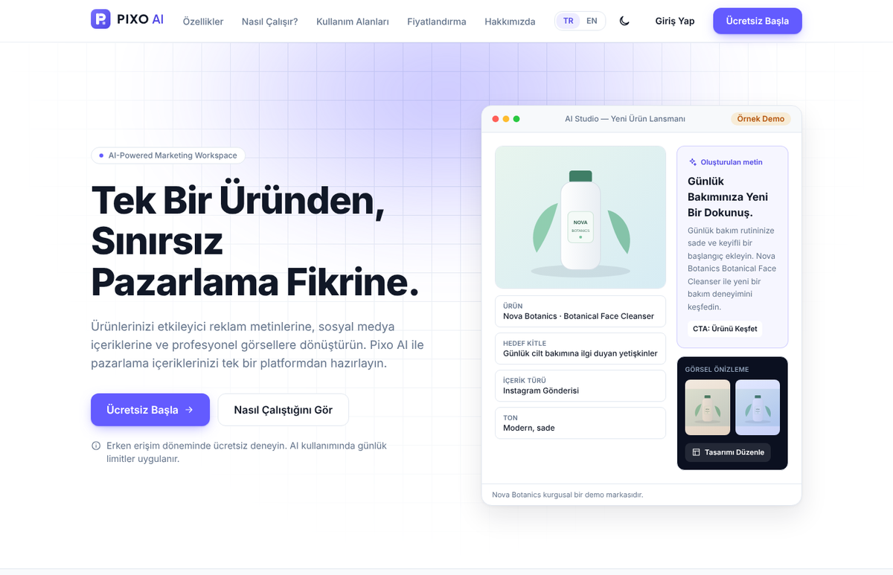
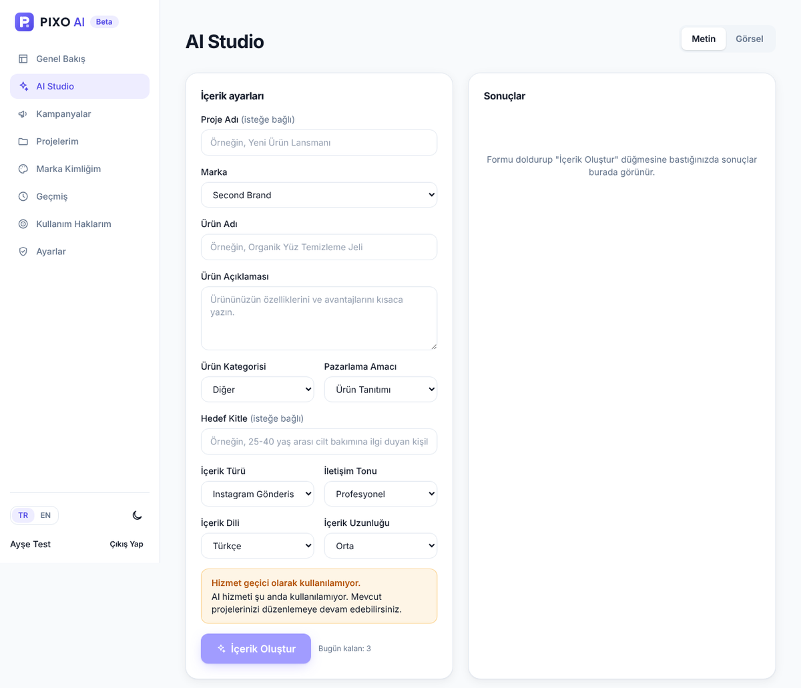
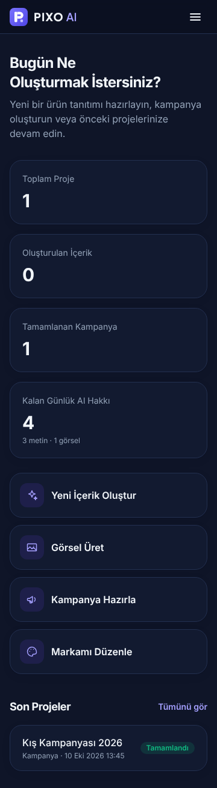
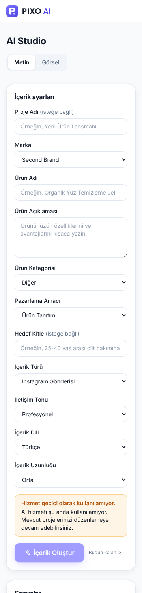
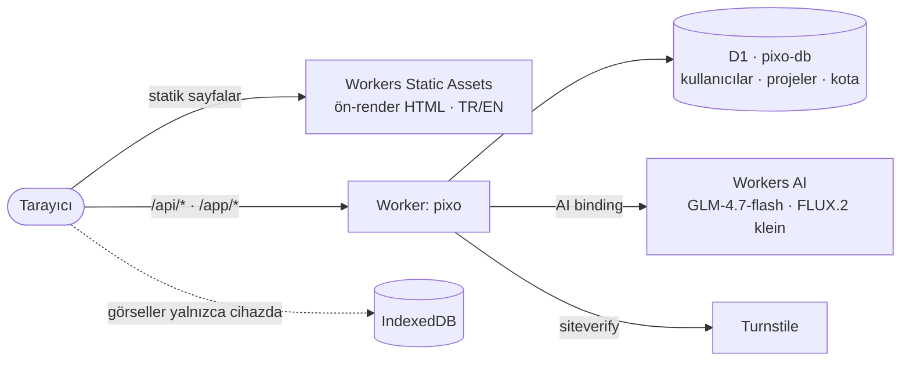

<div align="center">

<a href="https://pixo.tr">
  <picture>
    <source media="(prefers-color-scheme: dark)" srcset="public/logo-dark.svg">
    
  </picture>
</a>

### Create smarter. Market faster.
**Daha akıllı üret. Daha hızlı pazarlama yap.**

Ürün bilgilerinizi yapay zekâ ile pazarlama metinlerine, kampanya fikirlerine ve tanıtım görsellerine dönüştüren çalışma alanı.

[](https://pixo.tr)
[](docs/PHASE-2-3-REPORT.md)


-10B981)


[**Siteyi aç**](https://pixo.tr) · [Özellikler](#-özellikler) · [Mimari](#-mimari) · [Hızlı başlangıç](#-hızlı-başlangıç) · [Dokümanlar](#-dokümanlar) · [English](#-in-english)

<br>



</div>

---

## ✨ Özellikler

<table>
<tr>
<td width="50%" valign="top">

### ✍️ AI Studio — Metin
Ürün, hedef kitle, amaç, içerik türü, ton, dil ve uzunluk seçin; Pixo iki alternatif üretsin. Her sonucu düzenleyin, kopyalayın, projeye kaydedin veya yeniden oluşturun.

`Instagram` · `Facebook` · `Reklam` · `Ürün açıklaması` · `SEO` · `Slogan` · `E-posta`

</td>
<td width="50%" valign="top">

### 🖼️ AI Studio — Görsel
Metinden veya ürün fotoğrafınızdan tanıtım görseli. 6 sahne, 6 stil, 4 en-boy oranı; PNG/JPG indirme. Görseller sunucuda **saklanmaz**, yalnızca sizin cihazınızda (IndexedDB) durur.

</td>
</tr>
<tr>
<td valign="top">

### 📣 Kampanya Oluşturucu
Tek AI isteğiyle eksiksiz paket: kampanya adı, ana mesaj, 3 reklam başlığı, 2 sosyal medya metni, kısa açıklama, CTA, görsel konsept ve yayın takvimi — hepsi düzenlenebilir.

</td>
<td valign="top">

### 🎨 Marka Kimliği
Renkler, hedef kitle, ton, kullanılacak ve kaçınılacak ifadeler. Seçtiğiniz marka her üretimde AI'ya bağlam olarak verilir.

</td>
</tr>
<tr>
<td valign="top">

### 🔐 Parolasız hesap
**Passkey** ile kayıt ve giriş (parmak izi, yüz tanıma, ekran kilidi). E-posta veya parola gerekmez; 10 tek kullanımlık kurtarma kodu ve birden fazla cihaz desteği.

</td>
<td valign="top">

### 📊 Kontrollü maliyet
Kullanıcı başına günlük kota (3 metin · 1 görsel), sistem geneli günlük bütçe, hata olursa hak iadesi, tekrar isteklere karşı idempotency ve tek tuşla AI kapatma.

</td>
</tr>
</table>

Ayrıca: projeler (arama, filtre, durum), üretim geçmişi, kullanım hakları, 5 adımlı karşılama sihirbazı, **Türkçe / İngilizce** arayüz, açık / koyu tema, KVKK ve gizlilik sayfaları, demo sayfası.

<div align="center">

| AI Studio | Mobil · koyu tema | Mobil · stüdyo |
|:---:|:---:|:---:|
|  |  |  |

</div>

## 🏗️ Mimari

Tamamen **Cloudflare ücretsiz katmanı** üzerinde; kredi kartı veya ücretli API gerekmez.



| Katman | Seçim |
|---|---|
| Frontend | React 19 · TypeScript · Vite 7 · Tailwind CSS 4 · React Router 7 |
| Render | Build sırasında ön-render (SSG) + hydrate → her sayfada gerçek `<title>`, meta, hreflang, JSON-LD |
| Backend | Cloudflare Worker (tek dağıtım birimi, statik sayfalar Worker çağrısı harcamaz) |
| Veri | Cloudflare D1, numaralı migration'lar |
| AI | Workers AI bağlantısı (Worker içinde API anahtarı yok); Claude için sağlayıcı arayüzü hazır |
| Güvenlik | Passkey · `__Host-` oturum çerezi · Turnstile · CSP · hız sınırları · kullanıcı izolasyonu |

Ayrıntılar: [docs/ARCHITECTURE.md](docs/ARCHITECTURE.md) · [docs/SECURITY.md](docs/SECURITY.md)

## 🚀 Hızlı başlangıç

```bash
npm install
cp .dev.vars.example .dev.vars      # yerel test anahtarları
npm run db:migrate:local            # yerel D1
npm run build                       # dist/ + ön-render
npm run dev:local                   # http://localhost:8787 (AI'sız tam yerel mod)
```

> Workers AI bağlantısı yerelde de Cloudflare hesabı ister. `dev:local` onu devre dışı bırakır (AI uç noktaları 503 döner); hesabınızla `npx wrangler dev` gerçek AI'ı kullanır.

| Komut | Açıklama |
|---|---|
| `npm run check` | typecheck + 57 test + build + SEO/sır kontrolleri |
| `npm run test:e2e` | Playwright: tüm public sayfalar × 3 ekran × 2 tema |
| `npm run test:e2e:app` | Playwright + sanal passkey cihazı: hesap, çalışma alanı, izolasyon, silme |
| `npm run deploy` | `check` geçerse `wrangler deploy` — canlı ortam, bkz. [DEPLOY](docs/DEPLOY.md) |

<details>
<summary><b>📁 Proje yapısı</b></summary>

```
src/
  pages/          Public sayfalar (ana sayfa, özellikler, fiyatlandırma, giriş, kayıt…)
  app/            Oturum açılmış uygulama (/app/*): stüdyo, kampanyalar, projeler…
  i18n/           tr.ts (kaynak) · en.ts (aynı tip, eksik çeviri = derleme hatası)
  components/     Logo, Header, Footer, ikonlar, ortak UI
  lib/            seo, api, passkey, IndexedDB, görsel araçları
worker/
  routes/         auth (passkey) · workspace · ai
  ai/             istemler · sağlayıcı · kota · çıktı doğrulama
shared/           Tarayıcı + Worker ortak doğrulama ve seçenekler
migrations/       D1 SQL (0001 iletişim, 0002 çekirdek)
scripts/          ön-render, build kontrolleri, e2e testleri, yerel geliştirme
tests/            birim + gerçek yerel D1 entegrasyon testleri
docs/             mimari, dağıtım, güvenlik, operasyon, raporlar
```

</details>

## 🗺️ Yol haritası

| Aşama | Kapsam | Durum |
|---|---|---|
| 1 · Foundation | Kurumsal site, TR/EN, SEO, responsive, iletişim formu | ✅ |
| 2 · AI MVP | Passkey hesaplar, marka, projeler, kota, AI metin ve görsel | 🟣 Yayında, canlı doğrulanıyor |
| 3 · Creative Workspace | Kampanya oluşturucu ✅ · tasarım editörü · şablon galerisi | 🟡 Kısmen |
| 4 · Advanced AI | Claude API, ürün analizi, çok adımlı pazarlama ajanı | ⚪ Planlanıyor |
| 5 · SaaS Growth | Yönetici paneli, ücretli paketler, ekipler | ⚪ Planlanıyor |

Dürüst durum raporu (neler test edildi, neler henüz doğrulanamadı): [docs/PHASE-2-3-REPORT.md](docs/PHASE-2-3-REPORT.md)

## 📚 Dokümanlar

| Doküman | İçerik |
|---|---|
| [ARCHITECTURE](docs/ARCHITECTURE.md) | Mimari kararlar, tasarım sistemi |
| [DEPLOY](docs/DEPLOY.md) | Cloudflare kurulum ve dağıtım kontrol listesi |
| [SECURITY](docs/SECURITY.md) | Güvenlik kontrolleri |
| [OPERATIONS](docs/OPERATIONS.md) | Kotalar, AI kapatma, kullanıcı yönetimi, izleme |
| [PHASE-2-3-REPORT](docs/PHASE-2-3-REPORT.md) · [PHASE-1-REPORT](docs/PHASE-1-REPORT.md) | Test sonuçları ve bilinen eksikler |

## 🌍 In English

**Pixo AI** is an AI-powered marketing workspace that turns product information into marketing copy, coordinated campaign ideas and promotional visuals. It runs entirely on Cloudflare's free tier — Workers, Static Assets, D1, Workers AI and Turnstile — with passwordless **passkey** accounts, per-user and global AI quotas with automatic refunds, a bilingual (Turkish/English) interface and images that never leave the user's device. Early access / beta; see the [status report](docs/PHASE-2-3-REPORT.md) for what is verified and what is not yet.

---

<div align="center">
<sub>© 2026 Pixo AI · <a href="https://pixo.tr">pixo.tr</a> · Erken aşama bir girişimdir; Cloudflare veya Anthropic ile resmî bir ortaklığı yoktur.</sub>
</div>
